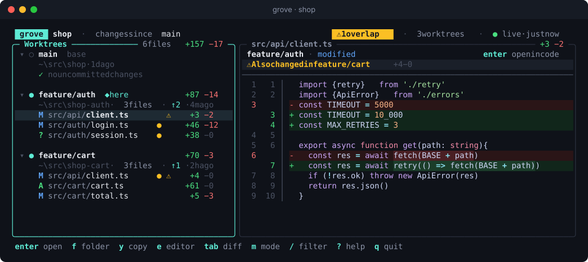

# grove

**See every git worktree at once: what each one changed, and where they collide.**

grove is a terminal UI for working on several features in parallel with
`git worktree`. It lists every worktree in a repository side by side, with
per-file `+`/`−` counts, a syntax-highlighted diff, and a warning whenever two
worktrees touch the same file, which is where your merge conflicts will come
from.



## Features

- **Every worktree in one view**, each with its branch, folder, commits
  ahead/behind the base branch, and last commit.
- **Per-file `+`/`−` counts** with a small diffstat bar, plus untracked files
  with their line counts.
- **Overlap warnings**: files changed in more than one worktree are flagged
  with `⚠`, counted in the header, and listed in each worktree's summary.
  Press `o` to show only those files.
- **Merge worktrees**: press `c` on a worktree to preview merging other
  worktrees' branches into it, choose which, and merge them in order. A
  conflict can be handed to the worktree's agent. See *Merging worktrees*.
- **Overview**: a summary above the list, and `w` for a table of every
  worktree, its agent and what needs your attention.
- **Two modes** (toggle with `m`):
  - *branch*: everything a worktree changed since it left the base branch,
    committed or not. A worktree with five commits never looks "clean".
  - *uncommitted*: only work that isn't committed yet.
- **Syntax-highlighted diffs** with line numbers, word-level change
  highlighting and hunk jumping (`n` / `N`).
- **Open anything**: `enter` opens a file in its system default program, `f`
  shows it in Explorer/Finder, `e` opens the whole worktree in your editor and
  `y` copies the path.
- **Live**: rescans every few seconds while the terminal is focused, slows
  down when it isn't, and refreshes the moment you come back. Background scans
  never take git's index lock, so they can't get in the way of your own git
  commands.
- **AI agents per worktree, and a planner that runs them**: describe a
  feature, and the planner splits it into tasks, each in its own worktree
  with its own agent. Put the planner in charge and it approves their
  commands, answers their questions, helps the ones that get stuck, merges
  and tests the result and opens a pull request: all you do is review it.
  See *Planner*.
- **Desktop notifications** while you're in another window: an agent
  finished, needs you or failed, a plan is ready or done, or two worktrees
  start to conflict. See *Notifications*.
- **Every action one search away**: `ctrl+k` lists what you can do with
  the selection, with each action's key. Type to find one and press `enter`.
- Light and dark themes chosen from your terminal's background, mouse
  support, a fuzzy file filter (`/`), and a layout that adapts down to 50×12.

## Install

Requires git and [Go](https://go.dev/dl/). grove builds with Go 1.26; any Go
from 1.21 on downloads that toolchain automatically.

```powershell
go install github.com/azeem-yousaf/grove@latest
```

That puts `grove` in Go's bin folder (`%USERPROFILE%\go\bin` on Windows,
`~/go/bin` elsewhere), which the Go installer adds to your PATH. Run the same
command again to update.

From a clone:

```powershell
go install .              # install your local build
# or
go build -o grove.exe .
```

The version you are running is shown next to the logo in grove's header,
and by `grove --version`: a release number such as `0.1.3`, or
`dev-<commit>` for a build from a clone (`-dirty` when it had uncommitted
changes).

Every push to master that passes CI becomes a release on GitHub, with notes
listing its commits, so `@latest` is always the newest tested version.
Versions go up by a patch number each time; a commit message containing
`[minor]` bumps the minor version, and `[major]` or `BREAKING CHANGE` the
major one.

## Use

Run it anywhere inside a repository:

```powershell
grove                     # the repo in the current folder
grove C:\src\my-app       # or point at one
grove C:\src\my-app\.git  # a .git folder, any subfolder or a file works too
grove --mode uncommitted  # start in uncommitted mode
grove --base develop      # compare against a different branch
grove --plain             # print a text summary instead of the UI
```

In a repository with just one worktree, grove lists the first steps under
it: a new worktree (`n`), a plan (`P`), an agent (`a`) and the keys (`?`).

To start a feature, press `n` and type a branch name:

```
 New worktree

 Branch    feature/receipts
           ✓ new branch
 From      Development
 Folder    C:\src\my-app-feature-receipts

 [x] Copy .env, appsettings.Development.json
 [x] Run setup: dotnet restore
 [x] Open in code
```

- A new branch starts from your base branch and doesn't track it, so
  `git pull` and `git push` in the worktree never touch the base.
- An existing branch is checked out as is, and a branch that only exists on
  the remote (`feature/x` or `origin/feature/x`) gets a local branch that
  tracks it. A branch already checked out in another worktree is refused,
  with that worktree's name.
- The folder is suggested next to the main worktree and follows the branch
  name until you type your own.
- Files git ignores, which a new worktree wouldn't otherwise get, are
  copied from the main worktree. By default that's `.env` and `.env.local`;
  set your own under `[new] copy`. An optional `[new] setup` command runs in
  the new folder afterwards.

Plain `git worktree add` works too; grove picks new worktrees up on its own.

To run git in one worktree without leaving grove, select it (or any of its
files) and press `:`, then type the command, with or without the leading
`git`:

```
 feature/auth  git commit -m "Add session refresh"
```

grove hands the terminal to git while it runs, so editors, pagers and
prompts behave normally (`commit` without `-m`, `log`, `rebase -i`, `push`
asking for credentials). Press enter afterwards to return; the worktree is
rescanned straight away. `↑` brings back earlier commands.

### An AI agent per worktree

Press `a` on a worktree to give it an agent: Claude Code or Codex, whichever
is installed and signed in on your PC. grove never asks for an API key; it
runs the tool you already use. If both are installed, grove asks which to
use; tick *Remember my choice* (off by default) to stop it asking
(`ctrl+a` switches later; it's saved as `[ai] agent` in the config).

```
╭─ ✦ feature/auth · Claude Code ─────────────────── $0.04 ─╮
│ you  Add a remember-me checkbox to the login page        │
│      ↳ Read src/auth/login.ts                            │
│      ↳ Edit src/auth/login.ts                            │
│                                                          │
│ ✦    Added the checkbox. When you're happy:              │
│        git commit -am "Add remember me"                  │
│──────────────────────────────────────────────────────────│
│ Claude Code wants to run                                 │
│ npm test -- auth                                         │
│ enter allow  esc deny                                    │
╰──────────────────────────────────────────────────────────╯
```

- Each worktree has its own agent and conversation, and they can work at
  the same time. The worktree's dot in the list shows what its agent is
  doing (spinning while it works, amber `✦` when it needs you), files it
  changed get a `✦`, and a toast tells you when an agent in another
  worktree finishes or needs you. While you're in another window, a
  desktop notification does (see *Notifications*).
- **An agent edits only its own worktree.** It runs in that folder, is told
  the paths of the other worktrees and to keep out of them, and:
  - with Claude Code, edits inside the folder are accepted, while shell
    commands and anything outside the folder are refused unless you allow
    them. Refused commands come back as cards (`enter` allow, `esc` deny);
    files outside the worktree are simply blocked.
  - with Codex, its `workspace-write` sandbox limits writes to the folder.
    Codex can still read outside it, so isolation is stronger with Claude
    Code.
- **Agents handle their own git, but never your protected branches.**
  Routine git on the agent's own branch (add, commit, branch, merging
  feature branches, rebasing work that isn't pushed, pushing its branch)
  just runs. grove reads every git command an agent wants to run, without
  AI, and anything that changes a protected branch (main, master, the base
  branch and `[git] protected`), could lose work (deleting branches, force
  pushes, discarding changes) or could get around those checks waits for
  you as a card you can run (`enter`), edit in the `:` prompt (`e`) or
  skip. A git hook that only applies to the agents' git backs this up: the
  chat header shows `🛡 guarded` once grove has checked it works in that
  worktree. Your own git is never affected.
- **Test results show in the chat.** When an agent runs tests, the chat
  shows whether they passed and the end of their output.
- **Undo.** Before an agent's first turn grove takes a checkpoint of the
  worktree (a git tree object; your index, branch and files are untouched).
  `ctrl+z` in the chat, or `u` in the list, shows every file changed since
  and puts them back byte for byte.
- **Model.** Type `/model` in the chat to pick one (`/model sonnet` or any
  model name works too, `/model default` goes back). Until you do, Claude
  Code uses whatever `/model` is set to in Claude Code itself. Your choice
  applies from the next message and is remembered for new chats
  (`[ai] claude_model` / `codex_model` in the config).
- **Typing and copying.** The message box grows as you type or paste
  (`ctrl+v`, or your terminal's own paste) and keeps pasted line breaks;
  `enter` sends, `shift+enter` (or `ctrl+j`) starts a new line. `ctrl+y`
  copies the agent's last reply as it wrote it, and dragging over the
  conversation (here or in a group chat) copies those lines as plain text.
- **Replies are formatted.** Markdown in replies shows as styled text
  without its marks: bold, italics, code, links, headings, quotes, bullets
  and task boxes. Tables are laid out in columns that fit the pane; when
  one is too wide even with its cells wrapped, each row is listed as
  `Header: value` lines instead. Long lines in code blocks wrap, with `↪`
  marking where a line continues; copying them by dragging joins them
  back into one line.
- `ctrl+x` stops a working agent. Quitting while agents work asks first.
- **Conversations are kept.** Each agent's conversation, the commands you
  allowed and its undo checkpoint are saved in the repository's `.git/grove`
  folder (never committed) and come back when you reopen grove; Claude
  resumes the same session. A turn cut short by closing grove is marked as
  such. Removing a worktree deletes its saved conversation.
- Creating a worktree with `n` has a **Task** field: fill it in and the new
  worktree starts with its agent already at work (after the setup command,
  if there is one).

The agent reads your project's `CLAUDE.md` / `AGENTS.md` as usual. It
sends your code to Anthropic or OpenAI just as the tool would on its own.

### Planner

Press `P` to open the planner, an agent that reads the repository but never
changes it. Describe what you want built, or name a Jira issue or epic (with
Claude Code, the planner reads Jira through your Atlassian connector; it can
only read, never create or edit issues). It asks about anything unclear and
then proposes a plan: tasks, each with a branch and a brief for its agent,
and groups of tasks whose agents will need to coordinate.

Before you plan, grove asks who will watch the plan's agents while it runs:

- **You**: commands an agent was refused, questions it ends a turn with and
  group chats all wait for you, as with any other agent.
- **The planner**, which then takes charge. You review the pull request at
  the end, and that is all:

  - **Commands.** It answers every command an agent was refused. It approves
    what the task needs, git included, and denies the rest with what to do
    instead. Only destructive git (deleting branches or worktrees, force
    pushes, discarding work), changes to protected branches and commands
    that could get around grove's git checks are kept for you; it can't
    approve those. One it doesn't answer is asked about again, then denied
    so the agent carries on.
  - **Questions and stuck agents.** It answers agents' questions from the
    plan and the code. When an agent struggles (errors, failing builds or
    tests, missing tools) it looks at its worktree, runs what it needs
    there and tells it exactly what to do next. It never edits files
    itself. A failed task is diagnosed and started again; it is only marked
    failed if it can't be done at all.
  - **Finished work.** When a task's agent says it is done, the planner
    checks the work and sends back what is missing.
  - **Group chats.** It follows them and settles what agents are stuck on
    or disagree about, also when they keep waking each other.

  You can still answer anything first: an approval card says the planner
  will decide unless you do. Its decisions show in its chat and in each
  agent's chat, and turns that need nothing from you don't send desktop
  notifications. If it takes `[planner] max_decisions` (default 20) turns
  in a row without the plan moving forward, it pauses until you say
  something to it or to an agent.

  **A planner per group.** Each group of tasks gets its own planner, which
  owns that group: its agents' commands, questions, finished work and group
  chat go to it, and it can only act on its own group. The main planner
  keeps the isolated tasks and the plan chat, and merges the plan. Press `P`
  on a group in the list, or `ctrl+p` in its group chat, to see a group's
  planner and talk to it; `ctrl+g` in its chat opens the group chat.

  While a plan it watches is running, the planner may run any shell command
  without asking (to read a task's diff, run its tests or install what an
  agent needs), and the main planner gets grove's control tools through a
  small MCP server built into grove (`grove mcp-plan`): `tasks` (each
  task's status, the end of its agent's last reply and the commands it
  waits on), `message`, `approve`, `deny`, `mark`, `post`, `merge` and
  `close`. It can act with these during a turn as well as with its
  decisions block at the end.

  Once every task is finished or failed, the planner merges the plan for
  you. grove commits each finished task's worktree and merges the branches,
  in plan order, into a new worktree on a branch named after the plan
  (`plan/guest-checkout`, from the plan's base), so your own branches stay
  untouched. If a branch conflicts with the work merged so far, grove merges
  the plan's branch into that task's worktree, asks its agent to resolve
  the conflict, commits the merge when it is done and merges again.

  Then grove runs the plan's test command in the merged worktree: `[planner]
  test` from the config (for example `go test ./...` or `npm test`, run
  through `sh`, or `cmd.exe` on Windows), else the command the planner
  proposed with the plan; the plan review shows which. The result and the
  end of its output show in the planner's chat and the plan chat. If the
  tests fail, the planner works out which tasks cause the failures and
  sends them back to those agents, merging and testing again once they are
  done. With no test command, the planner works out how to test the result
  itself.

  **The pull request.** Once the tests pass, grove pushes the plan's branch
  and opens a pull request into the base branch with the GitHub CLI (`gh`),
  and tells you it is ready for review. grove reads the pull request every
  minute: your reviews, comments and comments on lines of code go to the
  planner, which sends the changes to the agents that own them and merges
  again, so the fixes land on the same pull request. When you merge the
  pull request (or close it), grove closes the plan. Without `gh`, or with
  `[planner] pull_requests = false`, the planner instead posts a summary in
  the plan chat and takes your feedback there.

Tick *Remember my choice* (off by default) to save the answer as
`[planner] watcher` and stop being asked.

The plan opens for review (`ctrl+o` in the planner brings it back). Nothing
is created until you start it:

- `enter` edits a task's title, branch and brief, `g` moves it between
  groups (or makes it isolated), `r` renames its group and `d` removes it.
  Start a group's name with an emoji (`🛒 Checkout`) to give it an icon in
  the list. The planner may suggest one.
- `o` switches who watches the plan between you and the planner.
- `s` checks that no branch or folder already exists and starts the plan.
  grove creates a worktree per task (copying the `[new] copy` files), and
  starts each task's agent with its brief, at most `[planner] max_agents`
  (default 3) at a time; the rest wait for a free slot.
- A task is finished when its agent ends a turn without needing you. A
  reply that ends with a question, or an approval card, keeps it working.
  Once every task has finished, the planner says so; review the worktrees
  and merge them with `c`. (A plan the planner watches is merged for you;
  see above.)

**Groups.** Agents of tasks in the same group share a group chat; agents of
isolated tasks don't get it at all. grove gives each grouped agent three
tools, through a small MCP server built into grove itself (`grove
mcp-group`, started by Claude Code or Codex): `members` (who is in the
group, their task and worktree), `post` (to everyone, or one member) and
`read` (new messages, optionally waiting for an answer). Agents are told to
read their messages when they start and before they finish, and to post
whatever their groupmates depend on. They may also read (never change)
their groupmates' worktrees, to match APIs and types: Claude Code is given
read-only permission for those folders, and every other worktree stays off
limits. (Codex's sandbox can read anywhere, so with Codex this is by
instruction only.)

In the list, a group's worktrees sit together in a box under the group's
name and icon:

```
╭─ ▾ 🛒 Checkout  2 worktrees  ✦ 1 working  ✓ 1/2 done ──── +131 −19 ─╮
│ ▾ ● feature/cart-api  ◆ here                             +122 −16   │
│     C:\src\shop-cart-api · 4 files · ↑4                             │
│     M src/api/cart.ts                          ⚠   +20 −4    ■■···  │
│                                                                     │
│ ▸ ✦ feature/cart-ui                                         +9 −3   │
╰─────────────────────────────────────────────────────────────────────╯
```

The header counts the group's worktrees, conflicts between them, agents
that need you, are working or failed, finished tasks and chat messages. The
border shows what most needs you: red when members will conflict, amber
when an agent waits for you, the accent colour while agents work. `enter`
or `←` folds the group to one line. Selecting the header shows a summary in
the right pane: each member's task and agent, which members will conflict
(with each other or with other worktrees), and the latest messages in the
group chat. In a narrow list the box becomes a bar down the left side.
Worktrees stay grouped for as long as they exist, also after the plan is
done.

Press `t` on a group's header or one of its worktrees (or `ctrl+g` in a
grouped agent's chat) to open the group chat. You see every message and
can post too; start with `@branch` to address one agent. When a message
arrives for an agent that isn't working, grove starts a turn so it can
answer, once the chat has been quiet for `[planner] settle` (default 15 s,
never more than a minute after the first message), so a burst of messages
costs one turn. To keep agents from waking each other forever, grove stops after
`[planner] max_wakeups` (default 6) wake-ups in a row in a group: then the
group's planner settles it if the planner is in charge, and otherwise grove
waits for you to post.

**Plan chat.** Every started plan also has a plan chat, for you, the
planner and all of the plan's agents (each gets it as a second set of the
same tools). It is where the planner posts news about the plan, such as
merges, test runs and the pull request. Anything you post there goes to the
planner, and anything you post in a group chat to that group's planner; agents are
only woken for messages addressed to them with `@branch`. Press `t` on an
isolated task's worktree or the plan's merged worktree to open it,
`ctrl+t` in a group chat to switch to it and back, or `ctrl+g` in the
planner's chat.

Plans, the planners' conversations and group chats are saved with the
agents' conversations and survive restarts.

### Overview of every worktree

A line above the list starts with anything that needs you (agents waiting
for approval or failed, unresolved merge conflicts), then a running plan's
progress, working and finished agents, active, clean and unreadable
worktrees, and commits ahead of and behind the base, as many as fit. The
header beside it counts worktrees, overlaps and conflicts. Selecting a
worktree shows its plan task, what its agent is doing with the start of its
latest reply, and its newest commits (`↑` for those not in the base branch
yet). Press `w` (or click the summary line)
for the full overview: running plans with their tasks' progress, a table of
every worktree with its files, `+`/`−` lines, agent status, its plan task
and group, commits ahead and behind, uncommitted edits,
overlaps and last commit, and a list of what needs attention. `enter`
jumps to the worktree in the list, `a` opens its agent and `c` merges into
it.

### Reviewing a worktree's changes

Press `v` on a worktree, or any of its files, to read every change it made
in one scroll, each file under its name. `v` again shows only what changed
since its agent's last turn began (grove snapshots the worktree before each
turn), and once more goes back to everything. `[` and `]` go from file to
file, `n` and `N` from change to change; a bar in the gutter marks the
current change. In any diff:

- `/` searches; matches are highlighted, and `n` / `N` go from one to the
  next until `esc` clears the search.
- `x` puts the current change back, after showing it: its `+` lines are
  taken out and its `−` lines put back in the file on disk, keeping the
  file's line endings. On a new file that deletes it; on a deleted file it
  brings it back.
- `>` opens the worktree's agent with the change quoted, ready for you to
  say what's wrong with it.

### Finishing a feature

Select a worktree and press `s` to ship it. The menu shows where it stands
and what you can do:

```
 Ship feature/auth

 c  Commit                2 files not committed yet
 p  Push                  2 commits not pushed yet
 r  Pull request          create one with gh
 m  Merge origin/main in  1 commit behind
 b  Rebase onto origin/main  1 commit behind · rewrites this branch's commits
```

- **Commit** opens a dialog with the message and every file with work not
  committed yet, all ticked (`tab` to the files, `space` unticks one, `a`
  ticks or unticks all). The message starts as the last commit message the
  worktree's agent suggested, else its plan task's title. Only the ticked
  files are committed; anything else you staged stays staged. During a
  merge the whole merge is committed, with git's merge message.
- **Push** pushes the branch, setting its upstream the first time.
- **Pull request** opens the branch's pull request in the browser, or runs
  `gh pr create` against the base branch if there is none. It needs the
  [GitHub CLI](https://cli.github.com), signed in.
- **Merge** and **Rebase** bring in the base branch, fetching it first when
  it is a remote branch such as `origin/main`. Work not committed yet is
  stashed and put back (`--autostash`). If a merge stops on conflicts,
  press `c` on the worktree to resolve them; a rebase that stops is
  finished with `: rebase --continue` or `: rebase --abort`.

Each runs in the terminal like the `:` prompt, so hooks, commit signing,
credential prompts and `gh`'s questions work as usual. A worktree's pull
request (`#12 open`, `draft`, `merged`, `closed`) shows in the list and in
its summary, refreshed every minute while `gh` works.

### Merging worktrees

Select the worktree to merge into and press `c`. grove checks every other
worktree's branch against it with `git merge-tree`, which changes nothing,
and shows how many commits each would bring and which files would
conflict. Choose branches with `space` (`a` for all) and press `enter` to
preview them in merge order: two branches that each merge cleanly can
still conflict with each other, and the preview shows where the run would
stop. `enter` again merges them one after another. The target must have no
uncommitted changes to tracked files.

If a merge stops on conflicts, grove shows the conflicted files and lets
you ask the worktree's agent to resolve them (`a`; it is told not to commit
or finish the merge, so you review first), open the worktree in your editor
(`e`), abort the merge (`x`), or leave it for later. Pressing `c` on a
worktree in the middle of a merge returns to this screen.

When a feature is done, select its worktree and press `d`. grove deletes the
folder and keeps the branch unless you tick *Also delete branch*, which also
shows how many commits aren't in the base branch yet. A worktree with
uncommitted changes is only removed after you tick *Discard uncommitted
changes*, and git double-checks, so a stale screen can't lose work. Locked
worktrees work the same way. The main worktree can't be removed.

### Notifications

While grove's terminal isn't focused, grove shows a desktop notification
when an agent finishes, needs you (a command to approve) or fails, when the
planner proposes a plan, a plan's pull request is ready for review or a plan
is done, when the planner or a group chat pauses to wait for you, and when
two worktrees start to conflict. For a plan the planner is in charge of,
only what needs you is notified.
Notifications that come within two seconds of each other are combined into
one. While the terminal is focused, the usual toasts are enough.

- Windows shows a toast (through Windows PowerShell, so it is listed as
  coming from PowerShell), macOS uses Notification Center, and Linux
  `notify-send`.
- It needs a terminal that tells programs when it gains and loses focus:
  Windows Terminal, iTerm2, WezTerm, kitty, Ghostty and most others do.
- `[notify] desktop = false` turns them off; `bell = true` also rings the
  terminal bell, which many terminals show by flashing the tab or taskbar
  button (and which works over SSH).

### Keys

| Key | Action |
|---|---|
| `↑` `↓` / `j` `k` | move |
| `←` `→` / `h` `l` | fold / unfold a worktree or group |
| `[` `]` | previous / next worktree or group |
| `tab` | switch between the list and the diff |
| `→` / `←` | into the diff from a file; back to the list from the diff's left edge |
| `enter` | open the file (or fold a worktree or group) |
| `f` | show in Explorer / Finder |
| `e` | open the worktree in your editor |
| `y` | copy the path |
| `n` | create a worktree (in the list) |
| `a` | open the worktree's AI agent |
| `P` | the planner: turn requirements into tasks and worktrees (on a group: that group's planner) |
| `t` | the group chat of a group or a grouped task's worktree, or the plan chat of any other task or a plan's merged worktree |
| `w` | overview of every worktree |
| `s` | ship: commit, push, pull request, update from the base branch |
| `c` | merge other worktrees' branches into this one |
| `u` | undo everything the worktree's agent changed |
| `d` | remove the worktree (asks first) |
| `:` | run a git command in the selected worktree |
| `ctrl+k` | find any action and run it |
| `m` | toggle branch / uncommitted mode |
| `o` | show only files changed in several worktrees |
| `/` | filter files |
| `r` | refresh now |
| `n` `N` | next / previous hunk (diff pane), or search match |
| `v` | every change in the worktree; again for its agent's last turn |
| `/` `x` `>` | in the diff pane: search, put the current change back, ask the agent about it |
| `?` | all shortcuts |
| `q` | quit |

Double-click a file to open it.

### Legend

| Mark | Meaning |
|---|---|
| `●` (amber, next to a file) | has uncommitted edits |
| `⚠` | also changed in another worktree |
| `↑3 ↓1` | commits ahead of / behind the base branch |
| `■■■··` | size of the change; green for additions, red for deletions |
| `◆ here` | the worktree grove was started from |

## Configuration

Everything is optional. Create a starter file with:

```powershell
grove --init-config
```

It lives at `%AppData%\grove\config.toml` on Windows,
`~/Library/Application Support/grove/config.toml` on macOS and
`~/.config/grove/config.toml` on Linux.

```toml
base = ""            # branch to compare with; empty = origin/HEAD, then main, then master
mode = "branch"      # or "uncommitted"
refresh = "3s"       # how often to rescan while focused
editor = ""          # for `e`; empty = first of code, cursor, zed, subl on PATH
theme = "auto"       # "auto", "dark" or "light"

[new]                # new worktrees (key n)
copy = [".env", ".env.local", "appsettings.Development.json"]  # copied from the main worktree
setup = "dotnet restore"                                       # run in the new folder; "" = none
open_editor = false                                             # open new worktrees in the editor after creation

[ai]                 # the worktree agents (key a)
agent = "claude"     # "claude" or "codex"; "" = ask when both are installed
model = ""           # passed to the agent; "" = its default

[planner]            # plans (key P)
max_agents = 3       # task agents working at once; the rest wait
max_wakeups = 6      # wake-ups in a row in a group chat before waiting for you
max_decisions = 20   # turns in a row a planner takes without the plan moving forward
settle = "15s"       # quiet time in a chat before agents are woken (planner: at most 5s); "0s" = at once
watcher = ""         # who watches a plan's agents: "you" or "planner" (in charge); "" = ask before each plan
test = ""            # run in a merged plan's worktree, e.g. "go test ./..."; "" = the planner's suggestion
test_minutes = 20    # how long that may run before it is stopped
pull_requests = true # push a merged plan's branch and open a pull request with gh
model = ""           # the planner's model; "" = [ai]'s
crew_model = "sonnet" # group planners' model (a Claude alias is ignored for Codex)
task_model = ""      # the model of task agents a plan starts

[git]                # what agents may do with git on their own
protected = ["release/*"]  # branches agents never change without you; main, master and the base always are

[notify]             # while grove's terminal isn't focused
desktop = true       # desktop notifications
bell = false         # also ring the terminal bell

[open]               # per-extension override for `enter`
".log" = "notepad"
".md"  = "default"   # "default" = the system default program
```

**About `.ts` files on Windows:** Windows often registers `.ts` as an MPEG
video stream, so the "default program" for TypeScript can be a media player.
When an editor is available, grove sends `.ts`, `.mts` and `.cts` files to it
instead. Map them to `"default"` under `[open]` to turn that off.

## How it works

grove calls the real `git` CLI rather than a reimplementation, so it always
agrees with `git status` and `git diff`:

| What | Command |
|---|---|
| worktrees | `git worktree list --porcelain -z` |
| base branch | `git symbolic-ref refs/remotes/origin/HEAD`, else `main` / `master` |
| changed files | `git diff --numstat` and `--name-status` against the merge-base (branch mode) or `HEAD` |
| uncommitted / untracked | `git status --porcelain=v2 --untracked-files=all` |
| ahead / behind | `git rev-list --left-right --count base...HEAD` |

Every command runs with `GIT_OPTIONAL_LOCKS=0`, and worktrees are scanned in
parallel.

## Development

```powershell
go test ./...
go vet ./...
```

The UI tests drive the Bubble Tea model directly. To render a real
repository to text files for a visual check:

```powershell
$env:GROVE_DEMO = "C:\path\to\repo"; $env:GROVE_DUMP = "C:\tmp\shots"
go test ./internal/ui -run Dump -count=1
```

The README screenshot is rendered from the real UI. To update it after a UI
change:

```powershell
$env:GROVE_SHOT = "$PWD\docs\screenshot.svg"
go test ./internal/ui -run ReadmeShot -count=1
```

Built with [Bubble Tea](https://github.com/charmbracelet/bubbletea),
[Lip Gloss](https://github.com/charmbracelet/lipgloss),
[Bubbles](https://github.com/charmbracelet/bubbles) and
[Chroma](https://github.com/alecthomas/chroma).
